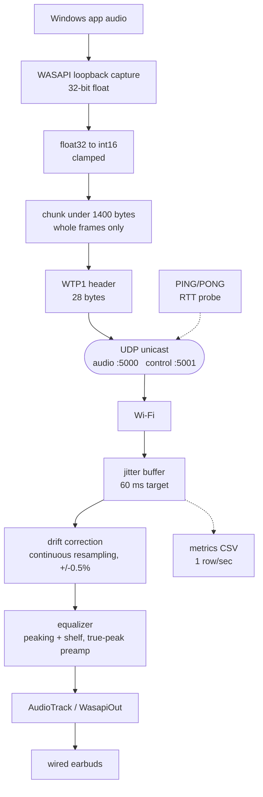

# Luma (Wired Tooth)

Streams a Windows PC's system audio over local Wi-Fi so that **wired** earbuds
plugged into a phone can play it with far less delay than Bluetooth.
The PC captures its own output, puts it on the network as uncompressed PCM,
and the phone plays it through the wire.

The repository is called Wired Tooth; the Android app is called Luma.

## Status

Working end to end over real Wi-Fi, Windows to a second device, with a
parametric equalizer on the receiver. Not finished: the headline latency
figure is still an estimate, and nobody has judged any of it by ear.

| | |
|---|---|
| Sender | Windows, .NET 10, WASAPI loopback. Tray app with QR pairing. |
| Receiver | Android, Kotlin, AudioTrack. Built and tested on Windows. |
| Receiver | Windows console, kept permanently as the regression test. |
| Receiver | Python statistics-only, stdlib, for any second machine. |
| iPhone | **Source lost.** A built app still runs on one phone; it cannot be rebuilt, changed or reinstalled. Treat it as gone. |

A Swift receiver is still open work. Xcode is macOS-only, so Android was
substituted deliberately — see `docs/IOS_AUDIO.md` for the routing research
and `BUILD_PLAN.md` for the reasoning.

## The problem

Bluetooth audio is late. A2DP buffers, and the codec adds its own delay, so a
typical headset lands roughly 150–250 ms behind the picture. That is invisible
for music and unusable when you can see the cause: lips move before the words,
a key press sounds after you feel it.

Wired earbuds have none of that latency, but a phone's wired earbuds cannot
play a laptop's audio. This makes them.

## Measured

Two separate runs. Both are real measurements from this repository's own
tools; neither is an estimate.

**Over real Wi-Fi**, Windows sender to a Mac running the Python statistics
receiver:

| | |
|---|---|
| Packets | **13,721** |
| Loss | **0.04%** |
| Median RTT | **10.52 ms** |

**Over loopback**, 27.8 minutes continuous, which is where the drift control
loop is actually exercised:

| | |
|---|---|
| Buffer depth | mean **61.08 ms** against a 60 ms target |
| Drift across the run | **+0.54 ms** |
| Underruns | **0** |
| Packets lost | **0** of 251,487 |
| Wire bitrate | 1,566 kbit/s (PCM16 48 kHz stereo + headers) |

### What is only an estimate

**End-to-end latency, ~110 ms.** This is arithmetic, not a measurement:
RTT/2 + buffer + the output latency the device was *asked* for. It assumes a
symmetric network path, uses a requested figure rather than a delivered one,
and excludes everything before the packet leaves — WASAPI's own capture
buffer, and the delay between an application producing a sample and loopback
handing it over.

The honest number comes from the acoustic method in `docs/MEASUREMENT.md`,
which **has not been performed**. There is deliberately no Bluetooth
comparison table here: doing that properly needs the acoustic measurement and
a Bluetooth headset, and inventing one would be the easiest lie in the
project.

## The equalizer

On the Android receiver, in the signal path, with no added latency — these are
IIR biquads, so the output depends on the current input sample and nothing is
delayed waiting for it.

- **Ten bands**, one per octave from 31 Hz, plus up to ten more from a loaded
  profile. Peaking, low-shelf and high-shelf sections, written from the public
  RBJ Audio EQ Cookbook and cross-checked once against AutoEq's own
  coefficient expressions: the two agree to **0.0005 dB**.
- **True-peak headroom.** The preamp is measured from a 256-point scan of the
  combined response, not guessed from the largest band, because overlapping
  bands sum to more than any one of them. The figure shown on screen is the
  reduction actually applied.
- **A shared gain budget.** A ceiling on each filter does not bound a cascade —
  ten filters at +8 dB on one frequency is +80 dB, which the preamp would
  faithfully subtract, leaving silence. The combined peak is bounded instead,
  so the headroom line can never read worse than **−14.0 dB**.
- **Fair A/B.** Compare matches loudness in the power domain before switching,
  so you hear the tone change and not a volume change. It only ever turns the
  *unprocessed* side down, so comparing costs no headroom.
- **Earbud profiles.** Import a correction from a file or by pasting text, in
  our own `luma-profile 1` format or the parametric-EQ text format other tools
  write. Preview before applying, export, remove. No new Android permission:
  the system file picker carries its own grant.
- **No bundled profile data.** None, from any third party. The app knows how
  to read a profile; it does not ship one.

Both parsers are total — malformed input is dropped and counted, never thrown
on. See **Known gaps** for what that does and does not prove.

## Tests

| | |
|---|---|
| Android unit tests | **157** |
| Android instrumented tests | **22** |
| C# tests | **none** |

The C# sender and the Windows console receiver have no automated tests at
all. They are exercised by running them.

Fuzzing, all on the Kotlin side:

- **WTP1 packet parser** — 17 hand-written bad cases, all 11,220 single-byte
  mutations of a valid packet, and 20,000 random datagrams. Zero exceptions.
- **Profile parser** — 69,390 single-byte mutations of two valid files (every
  byte replaced by every value, plus a deletion at every position) and 20,000
  random inputs: random bytes, random Unicode, 4,000-digit numbers, repeated
  keywords, size-boundary cases. Zero exceptions, every result finite and
  inside the engine's limits. Worst parse time on 64 KB of hostile input:
  **3.02 ms** against a 50 ms budget.

## Build

### Windows side

Requires the **.NET 10 SDK on Windows** — specifically Windows, because
capture is WASAPI loopback, playback is WASAPI shared mode, and the tray app
is WPF. There is no cross-platform build.

```
dotnet build WiredTooth.sln
```

NAudio and QRCoder restore from NuGet.

### Android side

Requires the Android SDK; builds on Windows with no Mac involved.

```
cd AndroidReceiver && ./gradlew assembleDebug
```

```
cd AndroidReceiver && ./gradlew testDebugUnitTest
```

Instrumented tests need a device or emulator. Because Gradle uninstalls both
APKs when `connectedAndroidTest` finishes — taking any screenshots with it —
the acceptance runs install manually and drive `am instrument` directly.

### Python tooling

The applications need no Python. The analysis tools do, and they deliberately
do not share one dependency list: the tool most likely to run on a borrowed
machine has none.

| Tool | Needs |
|---|---|
| `MacReceiver/receiver_stats.py` | **nothing** — stdlib only |
| `tools/plot_metrics.py` | `matplotlib` |
| `tools/acoustic.py` | `numpy` |

## Run

**The Windows app**, the normal way:

```
dotnet run --project WiredTooth.Windows
```

Shows whether it is streaming, a pairing QR encoding `wiredtooth://<ip>:5000`,
the phones connected, and session stats. "If it isn't working" runs read-only
checks — addresses, bound ports, Windows Firewall — and names the cause.
Closing the window keeps it streaming from the notification area.

**Console sender and receiver**, the debugging path. Start the receiver first;
the sender does not transmit until a client says `HELLO`:

```
dotnet run --project NetworkTest
```

```
dotnet run --project NetworkClient
```

The receiver writes `metrics_<timestamp>.csv`, one row per second.

**Statistics-only receiver** for a second machine with no audio stack. Exits
non-zero if loss reaches 1%, so it can gate a script:

```
python3 MacReceiver/receiver_stats.py 192.168.1.42 --seconds 120
```

**Diagnostics.** `AudioInspect` prints the capture format and raw samples —
the first thing to run when audio sounds wrong. `NetworkTest --waveout`
selects the old WinMM backend, which reproduces the 16.7% drain described in
`docs/ENGINEERING_NOTES.md`.

## Known gaps

- **No acoustic latency measurement.** The headline ~110 ms is an estimate and
  there is no Bluetooth comparison. The tooling is written and self-tested; it
  needs a microphone, the earbuds, and a Bluetooth headset.
- **Nothing has been judged by ear.** No preset, macro or imported correction
  in this app has ever been listened to through wired earbuds. The tests prove
  it applies what was asked for, not that the result is any good.
  `docs/LISTENING_TEST.md` is the procedure; its boxes are empty.
- **The file picker and export have never been run.** Every automated UI test
  pasted text instead, so `ACTION_OPEN_DOCUMENT` and `ACTION_CREATE_DOCUMENT`
  have been drawn on screen and never opened. The no-permission claim rests on
  Android's documentation, not on a run.
- **No phone CPU figures.** Every timing number came from an emulator on a
  desktop CPU. None of them transfer, and none should be quoted as a phone
  number.
- **TalkBack is unverified in use.** Tests drove the accessibility tree, which
  proves labels exist and can be found; it does not prove the gestures are
  comfortable or the reading order sensible.
- **The iPhone app cannot be rebuilt.** Its source is lost.
- **No encryption or authentication.** Anything on the network that sends a
  valid `HELLO` receives the stream.
- **Uncompressed**, 1,566 kbit/s per client. The `codec` header field exists
  so Opus can be added without breaking compatibility; it is 0 and unused.
- **The Windows app cannot show latency, loss or buffer depth.** Those are
  measured at the receiver and WTP1 has no packet type to report them back.
  The window says so rather than displaying zeros.
- **IPv4 only.**

## What's next

1. **The acoustic measurement.** Everything else is guesswork until the number
   includes the parts no API reports.
2. **The listening test**, on a real phone with real earbuds.
3. **A `STATS` control packet**, so the sender can display what the receiver
   measures.
4. **The Swift receiver**, when a Mac is available.

## Architecture



The control channel runs alongside the audio, not inside it. The receiver
initiates with `HELLO`, which is what lets a phone connect without the PC
knowing its address in advance: the client's address is learned from the
source of its own packet.

Three decisions worth knowing, each explained where it lives:

- **UDP, never TCP.** A retransmission arriving 200 ms late is useless for
  live audio. A lost 5 ms beats a 200 ms freeze.
- **Drift correction is proportional with no integral term.** The steady-state
  offset a P controller leaves behind *is* the clock difference; an integrator
  would drive it to zero, wind up, and waver audibly.
- **`WasapiOut`, never `WaveOutEvent`.** Measured on this machine, same device
  and format, no networking: WinMM drained 16.7% slower than real time. No
  control loop can close that gap. `docs/ENGINEERING_NOTES.md`.

Full wire format: `docs/PROTOCOL.md`.

## Repository

| Path | Role |
|---|---|
| `WiredTooth.Protocol/` | WTP1 wire format. Shared, and mirrored by the Kotlin and Python receivers. |
| `WiredTooth.Sender/` | Capture, packetisation, control channel, device handling. |
| `WiredTooth.Windows/` | WPF tray app: status, QR pairing, connected phones, network checks. |
| `AndroidReceiver/` | Kotlin receiver: jitter buffer, drift correction, equalizer, profiles. |
| `NetworkClient/` | Console front-end over the same sender. |
| `NetworkTest/` | Windows console receiver. Kept permanently as the regression test. |
| `AudioInspect/` | Capture-format diagnostic. Never delete. |
| `MacReceiver/` | Stdlib Python statistics receiver. |
| `tools/` | `plot_metrics.py` charts a run; `acoustic.py` measures real latency. |
| `docs/` | Protocol, measurement method, iOS routing, engineering notes, listening test. |
| `BUILD_PLAN.md` | Work packages and the honestly-scored v1.0 criteria. |
